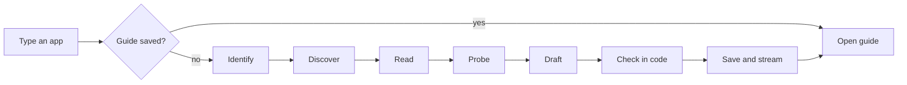

<p align="center">
  
</p>

<p align="center">
  Before you build an OAuth integration, see how long it takes you, how long you will wait on the provider, and where it can go wrong.
</p>

<p align="center">
  <a href="https://jovial-faloodeh-fd8c22.netlify.app"></a>
</p>

<p align="center">
  <a href="https://jovial-faloodeh-fd8c22.netlify.app/g/github"></a>
  <a href="https://jovial-faloodeh-fd8c22.netlify.app/g/slack"></a>
  <a href="https://jovial-faloodeh-fd8c22.netlify.app/g/google"></a>
  <a href="https://jovial-faloodeh-fd8c22.netlify.app/g/salesforce"></a>
</p>


## The idea

An hour of setup and six weeks of waiting look identical from the outside. Waypoint shows you the difference before you start.

Type any app name or website. You get a one-page guide that opens with three numbers: **your time**, **the wait**, and **the difficulty**. Then come the steps, the traps, who does what, and a record of what was actually checked.

| Your time | The wait | Difficulty |
| :--- | :--- | :--- |
| Hands-on minutes, as a range | Days on the provider's side, or "Not published" | Easy, medium or hard, with one line of reason |


Hard is not the same as slow. Salesforce is heavy to set up but has little waiting. Slack is quick to set up but slower to approve. Most docs blur the two. Waypoint keeps them apart.


## Who does what

Every step carries a marker: an agent can help, it is your turn, or you are waiting on the provider. This is the column an agent builder plans their week around.


Items in the agent column are suggestions. Waypoint does not execute them.


## Watch it research

Four guides are prepared. Any other app is researched live by an agent that shows its work, then saved at a link you can share.


<details>
<summary><b>The seven stages</b></summary>



| Stage | What happens | Budget |
| :--- | :--- | :--- |
| Identify | One company, one canonical domain. If the name is ambiguous it asks once. | |
| Discover | OAuth docs, developer portal, review rules, Composio's managed directory | 4 searches |
| Read | Official domain first, one link deeper at most | 6 fetches, 8 s each |
| Probe | Public checks only: OAuth metadata, whether the portal loads | |
| Draft | One model call fills the schema, naming a source and excerpt per claim | 2 retries |
| Check | Code validates: schema, source ids, fetched URLs, excerpts, difficulty rubric | |
| Save and stream | Stored at a stable link, then sent to the browser | under 45 s |

The model drafts. Code checks. A claim marked Verified must carry an excerpt the server finds in the fetched page. If it does not match, the claim drops to Unverified before saving.

</details>


## Trust, made visible

| Label | Meaning |
| :--- | :--- |
| **Verified** | An official page we opened says it |
| **Observed** | We ran a public check and recorded the result |
| **Inferred** | From forums or reasoning, and labelled as such |
| **Unverified** | We could not establish it, and we say where to look |

The guide also states the furthest rung it reached: **read**, **opened**, **probed** or **attempted**. Reading a guide to registering an app is not the same as registering one, and the guide never blurs that.

The four prepared guides were drafted by the agent, then corrected by hand against provider documentation.

<details>
<summary><b>The guide schema, in short</b></summary>

Every guide is one validated object. The interface renders it and never guesses where something belongs.

```ts
Guide = {
  difficulty: 'easy' | 'medium' | 'hard' | 'depends' | 'unknown',
  hands_on:  Range | null,            // minutes
  waiting:   Range | null,            // days. null means "Not published"
  steps:     Step[],                  // who: 'agent' | 'you' | 'provider'
  claims:    Claim[],                 // level: verified | observed | inferred | unverified
  checks:    { level: 'read' | 'opened' | 'probed' | 'attempted', done: string[], not_done: string[] },
  sources:   Source[],                // official | supplemental | forum, with date opened
  generated_by: 'agent' | 'agent_reviewed',
}
```

Ranges carry a basis: published, reported or estimated. Unknown is never turned into a number. The difficulty rubric lives in code as well as in the prompt, so the code refuses "easy" when approval is required.

</details>


## Try it in two minutes

1. **[Open Google](https://jovial-faloodeh-fd8c22.netlify.app/g/google).** Read the three numbers, then the handoff markers.
2. **[Open Slack](https://jovial-faloodeh-fd8c22.netlify.app/g/slack).** Quick to set up, slower to approve. Compare it with Google.
3. **Type `Linear` or `HubSpot` on the home page.** Watch the research, then the guide, then "What we checked".
4. **Type a made-up name.** You get an honest "we couldn't find it", not an invented guide.
5. **Copy the link and open it in a private window.** The guide is saved.

<details>
<summary><b>Built against the brief</b></summary>

| The brief asked for | Where it lives |
| :--- | :--- |
| A library of ready guides | Four reviewed guides on the index |
| Any app by name or site, live | Search row, then live research |
| How easy or hard it is | Difficulty with a reason, top of every guide |
| Time and approval wait | Two separate ranges, or "Not published" |
| What an agent does, where I take over | A marker on every step |
| What was tested, what is uncertain | "What we checked", with sources and dates |
| Shareable | Every guide has its own link |

</details>

## What I checked, corrected, and could not verify

| App | The agent said | The source showed | What I did |
| :--- | :--- | :--- | :--- |
| Slack | Approval is needed for every app | Review applies to public distribution | Made the step conditional |
| Google | | | |
| Salesforce | | | |

**Could not verify:** Notion's review timeline. No official figure was found, so it stays "Not published".

## Choices I made

| I chose | Over | Because |
| :--- | :--- | :--- |
| Three numbers first | A long tutorial | People decide whether to start before they read the steps |
| Ranges and "Not published" | One confident estimate | Providers rarely publish review times, and false precision costs trust |
| Four guides plus live research | One hundred thin guides | Four different shapes show the range, and the live path shows it scales |
| Code that checks the model | Trusting the draft | A passage match makes "Verified" something you can test |
| No chat window | A chatbot front end | The guide is the product, not the last message of a conversation |

## Design

Quiet and editorial. Warm white, near-black ink, one blue accent used once per screen.

```
Background  #FAFAF8     Ink      #111111     Muted    #6B6B6B
Hairline    #E6E4DF     Accent   #1F4FD8
Verified    #2F5D50     Observed #3A6B78     Inferred #B45309     Unverified #9A9A9A
```

Instrument Serif for names, Inter for text, JetBrains Mono for numbers and addresses. One-pixel hairlines, no shadows, 4 px corners on controls. No emojis, no glow, no fake progress bars.

## What I would build next

Not built yet:

- **A situation switch.** "Just my team" or "Other people's accounts", changing the forecast and the steps.
- **A tick-off path.** Tick steps as you go, with progress kept in your browser.
- **A redirect URL field.** Type it once and it fills every step.
- **A link preview card.** A pasted link shows the app name and the three numbers.

## Run it

<details>
<summary><b>Local setup</b></summary>

Needs Node 20 or newer.

```bash
git clone https://github.com/GaneshEiGo/waypoint.git
cd waypoint
npm install
cp .env.example .env.local   # then add your keys
npm run dev
```

Open http://localhost:3000

| Variable | What it is for |
| :--- | :--- |
| `GROQ_API_KEY` | Drafting guides |
| `TAVILY_API_KEY` | Searching for official docs |
| `UPSTASH_REDIS_REST_URL` | Saving guides at permanent links |
| `UPSTASH_REDIS_REST_TOKEN` | Same |

The Upstash pair is optional locally. Without it, guides are saved to a local file. Never commit `.env.local`.

</details>

<details>
<summary><b>Deploy to Netlify</b></summary>

1. Import the repo into Netlify.
2. Add all four variables under Site settings, then Environment variables.
3. Set both Upstash variables for any real deployment. The local-file fallback does not persist on Netlify, so share links would stop working.
4. After deploying, research an app, reload its guide, and open the link in a private window to confirm it saved.

</details>

<details>
<summary><b>Repo map</b></summary>

```
app/
  layout.tsx              fonts and metadata
  globals.css             design tokens and all styles
  page.tsx                the index
  g/[slug]/page.tsx       a guide, or live research
  api/generate/route.ts   validate, run the agent, stream, save
components/
  IndexList.tsx           the list of guides
  Search.tsx              search row and the / shortcut
  Guide.tsx               the guide view
  Trace.tsx               live timeline and collapsed record
lib/
  schema.ts               the guide schema and its rules
  seeded.ts               the four reviewed guides
  agent.ts                the seven stages
  tools.ts                search, safe fetch, probes
  prompts.ts              all agent instructions
  store.ts                saved guides
assets/                   README animations, not source
```

Plus `package.json`, `tsconfig.json`, `next.config.ts`, `.env.example` and this README.

</details>

## Limits and safety

- No real approvals were submitted, and nothing here promises one.
- Live guides rely on public docs. If they are thin or behind a login, the guide is marked partial.
- Many providers do not publish review times. Those show as "Not published", never a guess.
- Research runs on serverless functions with time limits, so very slow providers may time out.
- Keys stay on the server. The app never asks for secrets or passwords.
- Fetching is https only, blocks private addresses, and is capped on size, time and count.
- Web pages are treated as untrusted text, never as instructions.


<p align="center">
  Built by <b>Ganesh Kaduri</b> for the Composio APM Integrations take-home.<br>
  <a href="mailto:kaduriganesh7@gmail.com">kaduriganesh7@gmail.com</a> · <a href="https://github.com/GaneshEiGo">GitHub</a> · <a href="https://www.linkedin.com/in/kaduri-ganesh-bbb327360">LinkedIn</a>
</p>
