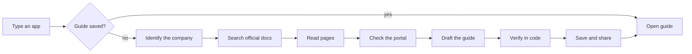

<p align="center">
  
</p>

<p align="center">
  Before you build an OAuth integration, see how long it takes, how long you'll wait, and where it can go wrong.
</p>

<p align="center">
  <a href="https://jovial-faloodeh-fd8c22.netlify.app"></a>
</p>

<p align="center">
  
  
  
  
  
</p>

<p align="center"><b>Open a guide</b></p>
<p align="center">
  <a href="https://jovial-faloodeh-fd8c22.netlify.app/g/github"></a>
  <a href="https://jovial-faloodeh-fd8c22.netlify.app/g/slack"></a>
  <a href="https://jovial-faloodeh-fd8c22.netlify.app/g/google"></a>
  <a href="https://jovial-faloodeh-fd8c22.netlify.app/g/salesforce"></a>
</p>

<p align="center"><b>Tap an app to open its forecast card</b></p>

<details>
<summary><b>GitHub</b> · Easy · 5–10 min · no wait</summary>
<br>
<a href="https://jovial-faloodeh-fd8c22.netlify.app/g/github"></a>
</details>

<details>
<summary><b>Slack</b> · Medium · 30–60 min · 1–5 days</summary>
<br>
<a href="https://jovial-faloodeh-fd8c22.netlify.app/g/slack"></a>
</details>

<details>
<summary><b>Google</b> · Hard · 120–180 min · 14–42 days</summary>
<br>
<a href="https://jovial-faloodeh-fd8c22.netlify.app/g/google"></a>
</details>

<details>
<summary><b>Salesforce</b> · Hard · 60–120 min · no wait</summary>
<br>
<a href="https://jovial-faloodeh-fd8c22.netlify.app/g/salesforce"></a>
</details>


## The idea

An hour of setup and six weeks of waiting look identical from the outside. Waypoint shows you the difference before you start.

Type any app name or website. You get a one-page guide that opens with three numbers: **your time**, **the wait**, and **the difficulty**. Then come the steps, the traps, who does what, and a record of what was actually checked.

<p align="center">
  
</p>

Hard is not the same as slow. Salesforce is heavy to set up but has no wait on the index. Slack is quick to set up but slower to approve. Most docs blur the two. Waypoint keeps them apart.


## Watch it research

Four guides are ready. Any other app is researched live by an agent that shows its work, then saves the guide at a link you can share.

<p align="center">
  
</p>

<details>
<summary><b>The stages, as a diagram</b></summary>



The model drafts. Code checks. If a claim is marked "verified" but its quoted passage isn't in the page we fetched, it drops to "unverified" before the guide is saved.

</details>


## What a guide looks like

<details open>
<summary><b>Google, as a sample</b></summary>

```
Google                              Cloud Console and verification
--------------------------------------------------------------------
YOUR TIME        WAITING            DIFFICULTY
120–180 min      14–42 days         Hard

Do you need your own app?    Yes. Required for API access.

THE PATH
01  Create a project             [ Your turn ]
02  Set up the consent screen    [ Your turn ]
03  Create credentials           [ Your turn ]
04  Verification                 [ Waiting on provider ]

WHAT WE CHECKED
verified    Verification is required for sensitive scopes.
sources     3 official pages, opened 2026-10-19
```

<!-- Replace with a real screenshot, or delete this line:
 -->

</details>

Every step says who does it: the agent can help, it's your turn, or you're waiting on the provider.

## A two-minute tour

1. **[Open Google](https://jovial-faloodeh-fd8c22.netlify.app/g/google).** Read the three numbers, then the handoff markers.
2. **[Open Slack](https://jovial-faloodeh-fd8c22.netlify.app/g/slack).** Quick to set up, slower to approve. Compare it with Google.
3. **Type `Linear` or `HubSpot` on the home page.** Watch the live research, then the guide, then "What we checked".
4. **Type a made-up name.** You get an honest "we couldn't find it", not an invented guide.
5. **Copy the link and open it in a private window.** The guide is saved.

<details>
<summary><b>Built against the brief</b></summary>

| The brief asked for | Where it lives |
| --- | --- |
| A library of ready guides | Four hand-checked guides on the index |
| Any app by name or site, live | Search row, then a live research page |
| How easy or hard it is | Difficulty with a one-line reason, top of every guide |
| Time, effort and approval wait | Two separate numbers, each a range, or "Not published" |
| What an agent does, and where I take over | A marker on every step |
| What was tested, and what is uncertain | "What we checked", with four evidence levels |
| Something shareable | Every guide has its own link |

</details>


## Trust, made visible

| Label | Meaning |
| --- | --- |
| **Verified** | An official page we opened says it |
| **Observed** | We ran a public check and recorded the result |
| **Inferred** | From forums or reasoning, and labelled as such |
| **Unverified** | We couldn't establish it, and we say where to look |

The four prepared guides were drafted by the agent, then corrected by hand against the sources.

## What I checked, corrected, and couldn't verify

| App | Agent said | What the source showed | What I did |
| --- | --- | --- | --- |
| Slack | Approval is needed for all apps | Review applies only to public distribution; private apps are instant | Made the step conditional |
| Salesforce | Nothing about refresh tokens | `[confirm against Salesforce docs]` | Added a "watch out" about refresh-token scope |
| Google | `[verification wait the agent drafted]` | `[what Google's page says, with link]` | `[corrected to ___]` |

**Could not verify:** Notion's review timeline. No official figure was found, so it stays "Not published".

## Choices I made

| I chose | Over | Because |
| --- | --- | --- |
| Three numbers first | A long tutorial | People decide whether to start before they read the steps |
| Ranges and "Not published" | One confident estimate | Providers rarely publish review times, and false precision costs trust |
| Four guides plus live research | 100 thin guides | Four different shapes prove the range, and the live path proves it scales |
| Code that checks the model | Trusting the draft | A passage match makes "verified" something you can test |

## What I'd build next

Not built yet:

- **A situation switch.** "Just my team" or "Other people's accounts", changing the forecast and the steps shown.
- **A tick-off path.** Tick steps as you go, with progress kept in your browser.
- **A redirect URL field.** Type it once and it fills every step.
- **A link preview card.** A pasted link shows the app name and the three numbers.


## Run it

<details>
<summary><b>Local setup, about two minutes</b></summary>

Needs Node 20 or newer.

```bash
git clone https://github.com/GaneshEiGo/waypoint.git
cd waypoint
npm install
cp .env.example .env.local   # then add your keys
npm run dev
```

Open http://localhost:3000

| Variable | What it's for |
| --- | --- |
| `GROQ_API_KEY` | Drafting guides |
| `TAVILY_API_KEY` | Searching for official docs |
| `UPSTASH_REDIS_REST_URL` | Saving guides at permanent links |
| `UPSTASH_REDIS_REST_TOKEN` | Same |

The Upstash pair is optional locally. Without it, guides are saved to a local file. Never commit `.env.local`.

</details>

<details>
<summary><b>Deploying to Netlify</b></summary>

1. Import the repo into Netlify.
2. Add all four variables under Site settings, then Environment variables.
3. Set both Upstash variables for any real deployment. On Netlify the local-file fallback does not keep guides between requests, so share links would stop working.
4. After deploying, research an app, reload its guide, and open the link in a private window to confirm it saved.

</details>

<details>
<summary><b>Repo map</b></summary>

```
app/
  layout.tsx              fonts and metadata
  globals.css             design tokens and all styles
  page.tsx                the index
  g/[slug]/page.tsx       a guide, or live research
  api/generate/route.ts   validate, run the agent, stream, save
components/
  IndexList.tsx           the list of guides
  Search.tsx              search row and the / shortcut
  Guide.tsx               the guide view
  Trace.tsx               live timeline and collapsed record
lib/
  schema.ts               the guide schema and its rules
  seeded.ts               the four reviewed guides
  agent.ts                the stages
  tools.ts                search, safe fetch, probes
  prompts.ts              all agent instructions
  store.ts                saved guides
assets/
  hero.svg  forecast.svg  trace.svg  divider.svg  live-app.svg
  guide-github.svg  guide-slack.svg  guide-google.svg  guide-salesforce.svg    README visuals, not source
```

Model: `[MODEL_NAME]` on Groq, through the OpenAI SDK.

</details>

## Limits and safety

- No real approvals were submitted, and nothing here promises one.
- Live guides rely on public docs. If they're thin or behind a login, the guide is marked partial.
- Many providers don't publish review times. Those show as "Not published", never a guess.
- Research runs on serverless functions with time limits, so very slow providers may time out.
- Keys stay on the server, and the app never asks for secrets or passwords.
- Fetching is https only, blocks private addresses, and is capped on size, time and count.
- Web pages are treated as untrusted text, never as instructions.


<p align="center">
  <a href="https://jovial-faloodeh-fd8c22.netlify.app"><b>Live app</b></a> · Built by <b>Ganesh Kaduri</b> for the Composio APM Integrations take-home.<br>
  <a href="mailto:kaduriganesh7@gmail.com">kaduriganesh7@gmail.com</a> · <a href="https://github.com/GaneshEiGo">GitHub</a> · <a href="https://www.linkedin.com/in/YOUR-HANDLE">LinkedIn</a>
</p>
