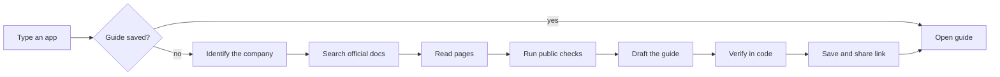

<h1 align="center">Waypoint</h1>

<p align="center">
  <b>Know what you're walking into.</b><br>
  OAuth setup guides for agent builders. How long it takes, how long you'll wait, what to watch for.
</p>

<p align="center">
  <a href="https://YOUR-APP.vercel.app"></a>
  
  
  
  
  
  
</p>

<p align="center">
  
</p>

---

## The 30-second version

Connecting an app to an agent often means creating your own OAuth app, and sometimes waiting for approval. One hour of setup and six weeks of waiting look identical from the outside.

Waypoint tells you which one you're facing before you start. Type any app. Get a one-page guide that opens with three numbers:

| Your time | Waiting | Difficulty |
| --- | --- | --- |
| hands-on work, as a range | provider approval, or "Not published" | Easy, Medium, Hard, or It depends |

Then come the steps, the traps, who does what (agent or you), and a plain record of what was actually checked.

## Try it

**Live:** https://YOUR-APP.vercel.app

| Try this | You'll see |
| --- | --- |
| [GitHub](https://YOUR-APP.vercel.app/g/github) | The fast case |
| [Slack](https://YOUR-APP.vercel.app/g/slack) | Quick setup, review only for public listing |
| [Google](https://YOUR-APP.vercel.app/g/google) | Requirements that depend on the access you ask for |
| [Salesforce](https://YOUR-APP.vercel.app/g/salesforce) | Many moving parts, little waiting |
| Type `Linear` or `HubSpot` | A real research run, then a saved link |
| Type a made-up name | An honest "we couldn't find it" instead of a made-up guide |

<p align="center">
  
</p>

## What makes it different

- **Forecast first.** Time, wait and difficulty come before any content.
- **It shows its work.** The agent's search-and-read trail travels with the guide. Share a guide, share the proof.
- **Ranges, not guesses.** "1 to 5 days" is a forecast. If the provider publishes nothing, it says "Not published".
- **Who does what.** Every step is marked: Agent can help, Your turn, or Waiting on provider.

## How it works



The model drafts. Code checks. Every source in a guide was really fetched, every "Verified" claim must carry an excerpt that appears in the page text, and anything that fails drops to "Unverified" before saving.

## How much to trust a guide

| Evidence | Meaning |
| --- | --- |
| Verified | An official page we opened says it |
| Observed | We ran a public check and recorded the result |
| Inferred | From forums or reasoning, and labelled as such |
| Unverified | We couldn't establish it, and we say where to look |

Every guide also states how far we got: **Read** the docs, **Opened** the portal pages, **Probed** public OAuth metadata, or **Attempted** a real setup.

The four reviewed guides were drafted by the agent and corrected by hand. Highest level reached: `[GitHub: ___ · Slack: ___ · Google: ___ · Salesforce: ___]`

## What I checked, corrected, and couldn't verify

| App | Agent said | Reality | What I did |
| --- | --- | --- | --- |
| `[app]` | `[claim]` | `[what the source or real attempt showed]` | `[corrected / kept / marked Unverified]` |
| `[app]` | `[claim]` | `[...]` | `[...]` |
| `[app]` | `[claim]` | `[...]` | `[...]` |
| `[app]` | `[claim]` | `[...]` | `[...]` |
| `[app]` | `[claim]` | `[...]` | `[...]` |

**Could not verify:** `[for example, a review timeline the provider doesn't publish]`

## Run it locally

<details>
<summary><b>Setup, about two minutes</b></summary>

Needs Node 20 or newer.

```bash
git clone https://github.com/YOUR-USERNAME/waypoint.git
cd waypoint
npm install
cp .env.example .env.local   # then fill in the values
npm run dev
```

Open http://localhost:3000

| Variable | What it's for |
| --- | --- |
| `ANTHROPIC_API_KEY` | Drafting guides |
| `MODEL_NAME` | Which Claude model to use |
| `TAVILY_API_KEY` | Web search and page text |
| `UPSTASH_REDIS_REST_URL` | Saved guides and rate limits |
| `UPSTASH_REDIS_REST_TOKEN` | Same |
| `NEXT_PUBLIC_APP_URL` | Used for share links and previews |

Upstash Redis has a free tier and installs from the Vercel Marketplace. Never commit `.env.local`.

</details>

## What's inside

<details>
<summary><b>19 files, nothing decorative</b></summary>

```
app/
  layout.tsx              fonts, metadata, shell
  globals.css             design tokens and styles
  page.tsx                the index
  g/[slug]/page.tsx       guide or live research
  g/[slug]/opengraph-image.tsx   link preview card
  api/generate/route.ts   validate, rate limit, stream, save
components/
  Search.tsx              search row and "/" shortcut
  Guide.tsx               the guide view
  Trace.tsx               live timeline and collapsed record
lib/
  schema.ts               the Guide schema
  prompts.ts              all agent instructions
  agent.ts                the research stages
  tools.ts                search, safe fetch, public checks
  store.ts                saved guides and limits
  seeded.ts               the four reviewed guides
```

Plus `package.json`, `tsconfig.json`, `.env.example` and this README. Six dependencies: next, react, react-dom, zod, @upstash/redis, @anthropic-ai/sdk.

</details>

## Decisions worth knowing

- **Four guides, not 100.** Four different shapes (instant, review wait, weeks, complex but fast) prove the approach better than a hundred thin ones.
- **Live generation is real research.** No hidden fallback. If search is down, the app says so.
- **A small database.** Live guides need links that survive a refresh and open for someone else.
- **One agent, clear stages.** Easier to check than a swarm.
- **Plain CSS.** One file, no framework, fewer moving parts.

## Limits

- No real approvals were submitted, and nothing here promises one.
- Live guides depend on public documentation. If it's thin or behind a login, the guide is marked partial.
- Many providers don't publish review times. Those show as "Not published", not a number.
- Provider rules change. Every guide is dated, with a "Check again" link after 30 days.

## Safety

- Keys stay on the server. Nothing secret is stored or asked for.
- Fetching is https only, blocks private addresses (re-checked on redirects), and is capped on size, time and count.
- Web pages are treated as untrusted text and never as instructions.
- Guide content renders as plain text.
- Rate limited per visitor.

---

<p align="center">
  Built by <b>Kaduri Ganesh</b> for the Composio APM Integrations take-home.<br>
  <a href="mailto:YOUR-EMAIL">YOUR-EMAIL</a> · <a href="https://www.linkedin.com/in/YOUR-HANDLE">LinkedIn</a>
</p>