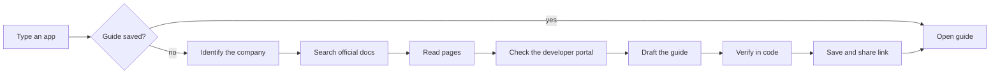

<h1 align="center">Waypoint</h1>

<p align="center">
  <b>Know what you're walking into.</b><br>
  OAuth setup guides for agent builders: how long it takes, how long you'll wait, what to watch for.
</p>

<p align="center">
  <a href="https://jovial-faloodeh-fd8c22.netlify.app"></a>
  
  
  
  
  
  
</p>

<p align="center">
  
</p>

---

## The 30-second version

When you connect an app to an agent, you often have to create your own OAuth app, and sometimes wait for approval. An hour of setup and six weeks of waiting look identical from the outside.

Waypoint tells you which one you're facing before you start. Type any app name or website. You get a one-page guide that opens with three things:

| Your time | Waiting | Difficulty |
| --- | --- | --- |
| Hands-on work, as a range | Provider approval, or "Not published" | Easy, medium, hard, or it depends |

Then come the steps, the traps, who does what (agent, you, or the provider), and a plain record of what was actually checked.

Four guides are ready. Any other app is researched live by an agent that shows its work and saves the guide at a link you can share.

## Try it

**Live:** https://jovial-faloodeh-fd8c22.netlify.app

| Try this | What you'll see |
| --- | --- |
| [GitHub](https://jovial-faloodeh-fd8c22.netlify.app/g/github) | The fast case: minutes, no wait |
| [Slack](https://jovial-faloodeh-fd8c22.netlify.app/g/slack) | Quick setup, with a review wait for public distribution |
| [Google](https://jovial-faloodeh-fd8c22.netlify.app/g/google) | Weeks of verification, depending on the scopes you ask for |
| [Salesforce](https://jovial-faloodeh-fd8c22.netlify.app/g/salesforce) | Many moving parts, little waiting |
| Type `Linear` or `HubSpot` | A live research run, then a saved link |
| Type a made-up name | An honest "we couldn't find it", not an invented guide |

<p align="center">
  
</p>

## What makes it different

- **Forecast first.** Time, wait and difficulty come before any content.
- **It shows its work.** The agent's search-and-read trail travels with the guide.
- **Ranges, not guesses.** "1 to 5 days" is a forecast. If the provider publishes nothing, it says "Not published".
- **Who does what.** Every step is marked: the agent can help, it's your turn, or you're waiting on the provider.

## How a guide is made



The model drafts. Code checks. If a claim is marked "verified" but the passage it quotes isn't in the fetched page, it drops to "unverified" before the guide is saved.

## How much to trust a guide

| Label | Meaning |
| --- | --- |
| Verified | An official page we opened says it |
| Observed | We ran a public check and recorded the result |
| Inferred | From forums or reasoning, and labelled as such |
| Unverified | We couldn't establish it, and we say where to look |

The four prepared guides were drafted by the agent, then corrected by hand against the sources.

## What I checked, corrected, and couldn't verify

| App | Agent said | What the source showed | What I did |
| --- | --- | --- | --- |
| Google | `[verification wait the agent drafted]` | `[what Google's page says, with link]` | `[corrected to ___, basis: published or estimated]` |
| Slack | Approval is needed for all apps | Review only applies to public distribution; private apps are instant | Made the step conditional ("if distributing publicly") |
| Salesforce | Nothing about refresh tokens | `[confirm against Salesforce docs]` | Added a "watch out" about the refresh-token scope |
| `[app]` | `[claim]` | `[reality]` | `[what changed]` |

**Could not verify:** Notion's review timeline. No official figure was found, so it stays "Not published".

## Run it locally

<details>
<summary><b>Setup, about two minutes</b></summary>

Needs Node 20 or newer.

```bash
git clone https://github.com/YOUR-USERNAME/waypoint.git
cd waypoint
npm install
cp .env.example .env.local   # then add your keys
npm run dev
```

Open http://localhost:3000

| Variable | What it's for |
| --- | --- |
| `GROQ_API_KEY` | Drafting guides |
| `TAVILY_API_KEY` | Searching for official docs |
| `UPSTASH_REDIS_REST_URL` | Saving guides at permanent links |
| `UPSTASH_REDIS_REST_TOKEN` | Same |

The Upstash pair is optional locally. Without it, guides are saved to a local file. Never commit `.env.local`.

</details>

<details>
<summary><b>Deploying to Netlify</b></summary>

1. Import the repo into Netlify.
2. Add all four variables above under Site settings, then Environment variables.
3. Set the two Upstash variables for any real deployment. On Netlify, the local-file fallback does not keep guides between requests, so share links would stop working.
4. After deploying, research an app, reload its guide, and open the link in a private window to confirm it saved.

</details>

## What's inside

<details>
<summary><b>20 files, nothing decorative</b></summary>

```
app/
  layout.tsx              fonts and metadata
  globals.css             design tokens and all styles
  page.tsx                the index
  g/[slug]/page.tsx       a guide, or live research
  api/generate/route.ts   validate, run the agent, stream, save
components/
  IndexList.tsx           the list of guides
  Search.tsx              search row and the / shortcut
  Guide.tsx               the guide view
  Trace.tsx               live timeline and collapsed record
lib/
  schema.ts               the guide schema and its rules
  seeded.ts               the four reviewed guides
  agent.ts                the seven stages
  tools.ts                search, safe fetch, probes
  prompts.ts              all agent instructions
  store.ts                saved guides
```

Plus `package.json`, `tsconfig.json`, `next.config.ts`, `.env.example` and this README.

</details>

## Decisions worth knowing

- **Four guides, not 100.** Four different shapes (instant, review wait, weeks, complex but fast) show the approach better than a hundred thin ones.
- **Live generation is real research.** There is no hidden fallback guide. If search fails, the app says so.
- **Saved guides.** Live guides need links that survive a reload and open for someone else, so they're stored in Redis.
- **One agent, seven clear stages.** Easier to check than a swarm.
- **Plain CSS.** One file, no framework, fewer moving parts.
- **Model:** `[MODEL_NAME]` on Groq, through the OpenAI SDK, for fast and reliable JSON.

## Limits

- No real approvals were submitted, and nothing here promises one.
- Live guides depend on public documentation. If it's thin or behind a login, the guide is marked partial.
- Many providers don't publish review times. Those show as "Not published", not a number.
- Provider rules change. Every guide shows the date its sources were opened.
- Research runs on serverless functions with time limits. Very slow providers may time out.

## Safety

- Keys stay on the server. The app never asks for secrets or passwords.
- Fetching is https only, blocks private addresses, and is capped on size, time and count.
- Web pages are treated as untrusted text, never as instructions.
- Guide content renders as plain text.

---

<p align="center">
  Built by <b>Ganesh</b> for the Composio APM Integrations take-home.<br>
  <a href="mailto:YOUR-EMAIL">YOUR-EMAIL</a> · <a href="https://www.linkedin.com/in/YOUR-HANDLE">LinkedIn</a>
</p>
